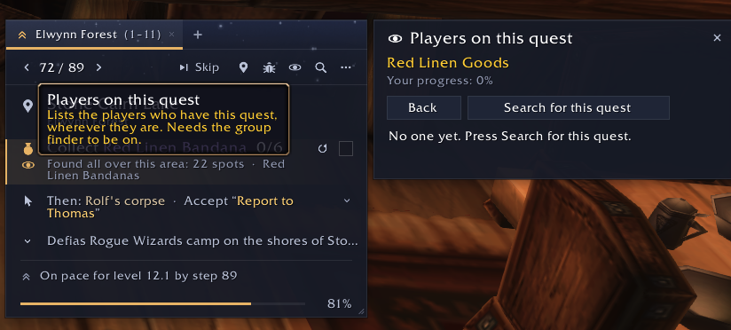
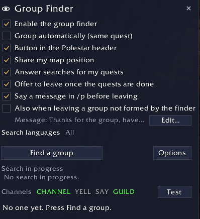
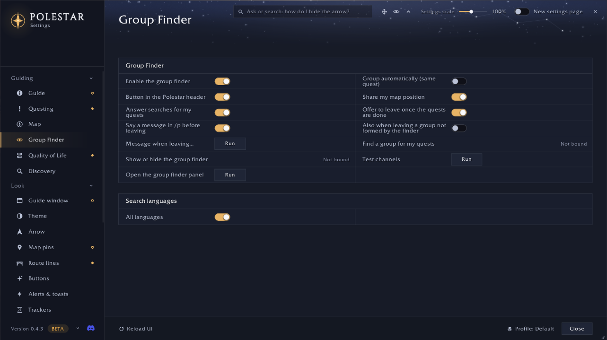
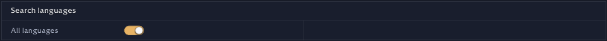
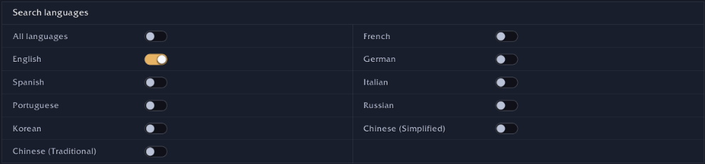

# Group Finder for Polestar (PSGroupFinder)

<p align="center">
  
</p>

An **optional** module for [Polestar](https://github.com/fitzforge/polestar) (WoW: Forever 1.60.1):
it finds players who are on **the same quest as you, near you** (kills, named elites, loot from
mobs, group quests) and lets you **whisper** or **invite** them. Grouping can be **automatic**
(an option, off by default).

It is a separate addon: it does not modify Polestar and also works without it (standalone window).
Licence: GPL-3.0-or-later (compatible with Polestar, GPL-3.0).

## Installation

> [!IMPORTANT]
> Download **`PSGroupFinder-1.0.0.zip`** from the
> [v1.0.0 release page](https://github.com/polestar-groupfinder/PSGroupFinder/releases/tag/v1.0.0) (under **Assets**).
> Do **not** use the “Source code (zip)” / “Source code (tar.gz)” links: they are not the addon.

1. Install [Polestar](https://www.curseforge.com/wow/addons/polestar) first.
2. On the [release page](https://github.com/polestar-groupfinder/PSGroupFinder/releases/tag/v1.0.0), download **`PSGroupFinder-1.0.0.zip`** and unzip it into
   `World of Warcraft/_forever_/Interface/AddOns/`. The final path must be exactly
   `AddOns/PSGroupFinder/PSGroupFinder.toc` (not a folder inside a folder).
   If you still have the old `Polestar_GroupFinder` folder, delete it.
3. Fully restart the game (a `/reload` does not load a new addon).

The full procedure (Windows and Mac paths, enabling the addon, a first two-account test)
is in [INSTALLATION.md](INSTALLATION.md).

## Features

| | |
|---|---|
|  | **The eye in the guide.** An eye joins Polestar's header (click to search) and sits on every quest step. |
|  | **Players on this quest.** Hover the eye on a step to see who has that quest, wherever they are, and search for it with one click. |
|  | **Floating panel.** Find a group, then Whisper or Invite, only ever on your click. Live channel status and a Test button. |
|  | **A page in Polestar's settings.** Enable it, tune it, bind keys and test channels without leaving Polestar's own window. |

### Search languages

Only your game language is ticked by default. Tick **All languages** and the list folds away;
untick it to choose languages one by one.

<p>
  <br>
  
</p>

## Usage

- **Enable**: `/psgf on`, or tick “Enable the group finder” in the panel.
  **Off by default**: while it is off, the addon joins no channel, sends nothing and listens to nothing.
- **Find a group**:
  - by default, an **eye icon** in the Polestar guide header, immediately to the left of the magnifying glass
    (left click = search, right click = panel; dimmed if the addon is off, tinted if a search is running).
    The “Button in the Polestar header” option: unchecking it brings back the older button under the
    window (that is also the fallback if the header hook fails);
  - or the button on the panel;
  - or a **key bind**: Esc > Options > Key Bindings > *Polestar* >
    “Find a group for my quests” (and “Show or hide the group finder”);
  - or `/psgf search`.
- **Search in progress**: one click opens a *session* on your relevant quests (the panel lists them).
  As soon as an **objective is done** (quest log: no open objective, “ready to turn in”, or the quest
  is gone), that quest **leaves the search** (1 s after the last log update), an updated search goes
  out to the players already found (and the hidden channel / the guild), and the search **continues
  for the other quests** in the same place. When none remain, the search stops and an `X` message
  tells the others. It also stops if you turn the addon off, enter an instance, click **Stop**
  (`/psgf stop`), or the group is full (5).
- **Results**: the panel (docked to the right of the Polestar window, to the left if the screen has
  no room, otherwise a movable window) lists the players found, sorted by shared quests (the current
  Polestar step first), distance (yards, otherwise “same zone”), already grouped or not, and the
  auto-invite state. Each row shows the player’s language (e.g. `EN`).
  **Whisper** and **Invite** buttons (only ever on your click). Hover a row: every shared quest.
- **Search languages**: by default, only the client language (`GetLocale()`, e.g. enUS → English)
  is ticked. You can tick others one by one. “All languages” (off by default) folds and hides the
  language list, and shows everyone. Filtering is **unilateral**: a player appears on your list if
  their game language is in your search (or if you ticked All). Each side filters on its own; for
  auto-grouping, each player must therefore appear on the other side. A v0.2 peer with no language
  is visible only if All is ticked. Configurable in the panel and in Polestar’s options.
- **Auto-grouping** (option “Group automatically (same quest)”, **off by default**): after *your*
  search, the addon invites the player it found (or asks them to invite you) and accepts their
  invitation, with no click. **Both** players must have the option on. Who invites: whoever is
  already in a group (and is leader) invites the solo player; two solos: the lower session id
  invites (the other sends them a `G` message); two groups: nobody. Same faction required, party
  of 5 at most, never inside an instance. An invitation is accepted only from an *expected* player
  (someone who started a search with the option and to whom you replied, or whom you asked).
- **Options** (saved in `PSGroupFinderDB`), in the panel **and**, with Polestar, on a “Group Finder”
  page in Polestar’s options (enable, group automatically, header button, languages, position,
  answering, key binds, channel test). Every setting has a tooltip on hover:
  - enable / disable; group automatically;
  - button in the Polestar header (on by default);
  - search languages (default: game language only; “All” is opt-in);
  - share my map position (otherwise only the zone is sent);
  - answer searches for my quests;
  - offer to leave once the group’s quests are done (on by default), and say a message in /p
    before leaving (off by default, editable text).
- **Players on this quest** (1.1): a small button (the eye) opens the panel in “quest mode”,
  the list of players who have **this** quest, wherever they are, with their zone, their progress,
  Whisper and Invite; **Search for this quest** queries them (the quest is identified by its id).
  The button is:
  1. in the Polestar guide window, under the objective icon, to the left of the sub-line;
  2. offered in the objective tooltip (“Alt-click: see the players on this quest”);
  3. in the game’s quest log, to the right of each quest’s tracking checkbox
     (the title is shortened so it does not run under the button);
  4. in the Map & Quest Log details view, to the left of Back (or to the right of Track).
  A second click on the same trigger closes the pane; a click for another quest switches to it.
  Without Polestar, the log / details buttons and `/psgf quest <id>` remain.
- **Leave the group** (1.1): for a group formed through the addon, when every quest you grouped
  for is done, a window offers **Leave** / **Stay**. The /p message (optional) is also sent if you
  leave through the game (portrait, `/leave`) or with the panel’s **Leave the group** button
  (visible only while in a group). Never on its own. Option “Also when leaving a group not formed
  by the finder” (`leaveMsgAny`, off) covers a group you joined by hand.
- **Commands**: `/psgf` (panel), `/psgf search`, `/psgf stop`, `/psgf on|off`, `/psgf test`
  (tests the channels), `/psgf reset` (repositions the panel), `/psgf quest <id>` (list for one
  quest), `/psgf hooks` (what was found on Polestar and in the quest log), `/psgf debug`.

## What is sent

Only when the addon is on, as hidden addon messages (prefix `PSGF`, ≤ 255 bytes):

| Message | When | Contents |
|---|---|---|
| Search `S` | your click / key bind, at most every 20 s; resent **without a click** (hidden channel, guild, whisper to players already found) when an objective is done | up to ~12 remaining quest IDs with their kind (kill, named, loot, group), map, x/y (if shared), level, class, party size, flags (`g` auto-group, faction `A`/`H`), client language (e.g. `e`) |
| Reply `R` | addon whisper to the searcher, at most 1×/20 s per player | only the IDs of **shared** quests, your map/position, level, class, flags, client language |
| End `X` | last quest done, stop, group full | your session id: the others drop you from their list |
| Request `G` | auto-group option, whispered to the player who should invite you | the IDs of the shared quests |
| Quest search `Q` (1.1) | your click on a quest button, at most every 15 s | the id of **one** quest, map, x/y (if shared), level, class, party size, flags, client language |
| Quest reply `A` (1.1) | whisper to the requester, if you have the quest in your log (any zone), at most 1×/20 s per requester and per quest | that id and your progress in % (100: done or ready to turn in), your position, level, class, language |
| Test `T` | `/psgf test`, or once after enabling | a random id (we listen for our own echo) |

Never free text, never the whole quest log, nothing inside an instance.

## Channels and detection

Order tried: **CHANNEL** (hidden `PSGroupFinder` channel, removed from the chat tabs and joined
6 s after login so it does not take /1 or /2), then **YELL**, **SAY** (limited range),
**GUILD**. Replies go over **WHISPER**.

The addon detects in-game what works:

- the return code of `C_ChatInfo.SendAddonMessage` (`InvalidChannel`,
  `AddonMessageThrottle`, `NotInGuild`…);
- **echo**: a message that comes back proves the channel works.

The panel colours each channel: green = echo received, yellow = accepted with no echo,
red = refused, grey = unavailable. `/psgf test` details the result in chat.
A search goes out on the best public channel, plus guild if you have one.

Rate: a home-grown queue (burst of 4, then ~0.8 msg/s), retry on `AddonMessageThrottle`.
The search itself goes out immediately, in the click or key-press call (SAY/YELL may require
a hardware event).

## Integration with Polestar

| Uses | Status in Polestar | For |
|---|---|---|
| `Polestar.API.version == 1`, `Polestar.On("STEP_CHANGED" / "GUIDE_CHANGED" / "TABS_CHANGED")`, `Polestar.Compat.IsOnQuest` / `IsQuestReadyForTurnIn` | **public API** (docs/API.md) | know when the step changes, filter quests |
| `Polestar.Theme.Skin`, `Font`, `OnChanged` | **public Skin API** (capability `theme.functions`) | paint the panel and the button in the player’s look |
| `Polestar.Theme.GuideParts().window` | **public Skin API** (capability `guideParts`) | hook the button under the guide window and the panel to its right |
| `Polestar.RegisterOptions` (ARCHITECTURE.md “Options registry”, outside docs/API.md), under `pcall` | **semi-internal** | “Group Finder” page in Polestar’s options |
| public `icon` field of `RegisterOptions` (full path to `Media/icon-eye`) | **public** registry API | icon of our sidebar entry, the same eye as the header, 16×16 monochrome like Guide, Map, Questing and Discovery |
| `UI.Options.Kit.pages`, `Options.Grouped.NavItems`, `Widgets.NavRowAfter` | **internal**, under `pcall` | fallback if the grouped options page does not send the icon to indented rows |
| `Polestar.Theme.GuideReach`, `Polestar.Theme.Skin(…, "checkbox" / "close")`, `Theme.Hex` | **public Skin API** | avoid the bottom-edge tabs; checkboxes and close button in the Polestar look |
| `Polestar.UI.ShowOptions(key)` | **internal**, under `pcall` | panel “Options” button (hidden if missing) |
| `Polestar.Engine.GetGuide()` / `GetLiveStep()` and `step.goals[].quest` | **internal**, called under `pcall` | put the current step’s quests first |
| `Polestar.Compat.GetPlayerMapPosition()` | **internal**, under `pcall` | position (otherwise `C_Map`) |
| `Polestar.Theme.GuideParts().rows` (pooled objective rows), and on each row `psGoal`, `Icon`, `Check`, `Alt` | `rows` documented in the skins reference; the row fields are **internal** | quest button under the objective icon |
| `Polestar.QuestClickTips(questID, lines)` and `Polestar.QuestRowClick(questID, button)` | **internal** (called by name on every tooltip / click); wrapped under `pcall`, the original always runs first | “Alt-click” help line and Alt-click |

If an internal hook changes in a Polestar version, the addon falls back to the client’s quest log
and `C_Map`. Without Polestar, or with a different API version, it is a standalone window.

## Game quest log (1.1)

The per-quest button hooks **`QuestScrollFrame.titleFramePool`** (the Map & Quest Log, title
buttons with `.questID` and `.Checkbox`), otherwise children of its content that carry a
`questID`, otherwise the classic `QuestLogTitle1…N` buttons. It is placed **to the right of the
tracking checkbox** (3 px, same column if there is no checkbox); the title is shortened
(`SetPoint` RIGHT) so it does not run underneath. The button is a **child** of the title button
(it follows recycled rows); it is repositioned after the log’s update functions (`hooksecurefunc`
only: nothing is replaced, and `QuestMapFrame_OpenToQuestDetails` is never called, which taints
Polestar, #2924) and every 0.5 s while a log is shown. On the details view
(`QuestMapFrame.DetailsFrame`, anchor `BackButton` or `TrackButton`), a second button hooks
`QuestMapFrame_ShowQuestDetails` and the details updates, under pcall. Forever’s frame names
could **not** be verified out of game (they come from Retail quest-log code and from what
Questie documents): `/psgf hooks` reports what was found (frame, id, button, anchor).

## Auto-grouping limits (to confirm in game)

- **Invite**: `InviteUnit` can be called from an event handler, with no key press (Forever
  auto-inviter addons do this); only the **leader** (or a solo player) can invite, 5 members
  at most, **same faction** (and same ruleset), no automatable guild invite.
- **Accept**: `AcceptGroup()` on `PARTY_INVITE_REQUEST` is documented for Classic, but
  **unconfirmed on Forever**. If the client refuses, the invitation window stays on screen and
  a chat message asks you to accept by hand.
- No `SendChatMessage` (SAY/YELL) without a hardware event: click-less updates go through the
  hidden channel, guild and addon whisper. A player only reached by YELL/SAY keeps the old list
  until their entry expires (5 min).
- Session names are used to decide who invites; two clients on different versions (v0.1 / v0.2)
  do not understand each other for the new features.

## Known limits / to test in game

- **CHANNEL**: WoW Classic has forbidden addon messages on custom channels since 1.13.3.
  On Forever they returned `InvalidChannel (7)` at launch (6 Nov 2026), then a player wrote
  “appears to be fixed”, with no confirmation from Blizzard. **Run `/psgf test`** to find out.
  Without CHANNEL, YELL/SAY only reach nearby players (often what you want for a kill quest)
  and GUILD only your guild.
- Trial / veteran accounts cannot send addon messages (1.60.1).
- “Item” quests do not say whether the item comes from a mob or the ground: they all count as
  “loot”.
- “Named elite” is a heuristic: a kill objective that asks for exactly 1 mob.
- Forever names include a last name (“Ana Smith”): whisper and invite use the name as the
  server sends it. To verify in game, especially across realms.
- Only other players **who have this addon and have enabled it** will answer.
- **1.1 fragilities** (nothing has been seen in the client): Forever quest-log and details frame
  names (`QuestMapFrame.DetailsFrame`, `BackButton`, `TrackButton`); title trimming depends on
  finding the FontString; Polestar goal-row height (≥ 36 to place the button under the icon,
  otherwise to the left of the checkbox); `QuestClickTips` / `QuestRowClick` / `row.psGoal` are
  internal to Polestar (without them: no help line and no Alt-click, the button remains); a
  1.0.x version does not answer quest searches (it ignores them). The /p message goes through
  `SendChatMessage` just before `LeaveParty` (a pre-hook, so possible taint if the game calls
  it securely — accepted, the player initiates the leave); if Forever refuses the message, the
  group is still left.
- Tested only out of game: `luac` + `luacheck` + a multi-client simulation (search, session,
  quest removal, auto-grouping, quest search, buttons, leave offer) with a fake WoW API and a
  fake Polestar (`lua5.1 tests/sim.lua`). Not yet tested in the client.

## Development

```
luacheck PSGroupFinder      # lint (config .luacheckrc)
lua5.1 tests/sim.lua        # multi-client simulation
./build.sh                  # versioned zip in ../polestar-groupfinder-release/
```

Inspired by the public descriptions of Group Up, QuestScout and Group Quest Finder
(CurseForge, “All Rights Reserved”): **none of those addons’ code was read or copied**.
