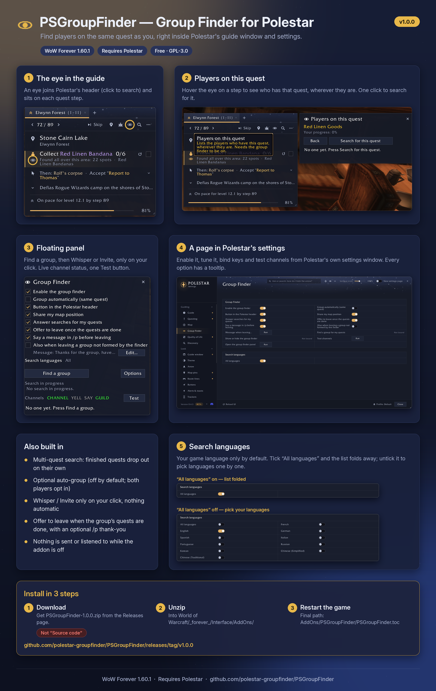
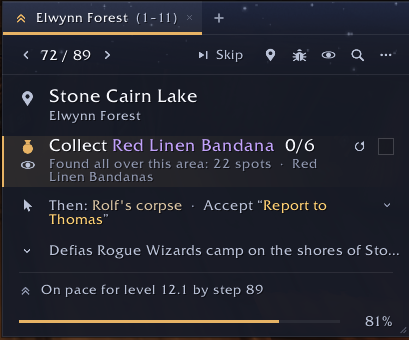

# Group Finder for Polestar (PSGroupFinder)

<p align="center">
  
</p>

An **optional** module for [Polestar](https://github.com/fitzforge/polestar) (WoW: Forever 1.60.1):
it finds players who are on **the same quest as you, near you** (kills, named elites, loot from
mobs, group quests) and lets you **whisper** or **invite** them. Grouping can be **automatic**
(an option, off by default).

It is a separate addon: it does not modify Polestar and also works without it (standalone window).
Licence: GPL-3.0-or-later (compatible with Polestar, GPL-3.0).

## Installation

> [!IMPORTANT]
> Download **`PSGroupFinder-<version>.zip`** from the
> [releases page](https://github.com/polestar-groupfinder/PSGroupFinder/releases) (under **Assets**).
> Do **not** use the “Source code (zip)” / “Source code (tar.gz)” links: they are not the addon.

1. Install [Polestar](https://www.curseforge.com/wow/addons/polestar) first.
2. Unzip the release zip into `World of Warcraft/_forever_/Interface/AddOns/`. The final path
   must be exactly `AddOns/PSGroupFinder/PSGroupFinder.toc` (not a folder inside a folder).
3. Fully restart the game (a `/reload` does not load a new addon).

The full procedure (Windows and Mac paths, enabling the addon, a first two-account test)
is in [INSTALLATION.md](INSTALLATION.md).

## Features

| | |
|---|---|
|  | **A button in the guide.** It joins Polestar's header (click to search) and sits on every quest step. |
|  | **Players on this quest.** Click the button on a step to see who has that quest, wherever they are, and search for it with one click. |
|  | **Floating panel.** Find a group, then Whisper or Invite, only ever on your click. Live channel status and a Test button. |
|  | **A page in Polestar's settings.** Enable it, tune it, bind keys and test channels without leaving Polestar's own window. |

> The screenshots predate the new group icon (two people), which replaced the eye.

## Usage

- **Enable**: `/psgf on`, or tick “Enable the group finder”. **Off by default**: while it is off,
  the addon joins no channel, sends nothing and listens to nothing.
- **Find a group**:
  - the **group icon** in the Polestar guide header, immediately left of the magnifying glass
    (left click = search, right click = panel; dimmed while the addon is off, tinted while a
    search runs). Unticking “Button in the Polestar header” puts a button under the window instead;
  - the **Find a group** button on the panel;
  - a **key bind**: Esc > Options > Key Bindings > *Polestar* > “Find a group for my quests”
    (and “Show or hide the group finder”);
  - `/psgf search`.
- **A search is a session** on your relevant quests. As soon as a quest's objectives are done
  (or it is ready to turn in, or gone), it leaves the search, the players already found are told,
  and the search **continues for the others**. It stops when none remain, when you click **Stop**
  (`/psgf stop`), turn the addon off, enter an instance, or your group is full.
- **Results**: the panel (docked beside the Polestar window, otherwise a movable window) lists the
  players found, best first: more shared quests (the current Polestar step above all), nearer,
  not already grouped. Each row shows the player's language (e.g. `EN`), and **Whisper** /
  **Invite** buttons. Hover a row for every shared quest.
- **Players on this quest**: the small group button under a Polestar objective icon (or
  **Alt-click** on the objective, or `/psgf quest <id>`) lists the players who have **that**
  quest, in any zone, with their zone and progress; **Search for this quest** asks everyone.
  A second click on the same quest closes the list; another quest switches to it.
- **Search languages**: by default only your game language is ticked. Tick others one by one,
  or **All languages** (the list folds away). Filtering is one-sided: a player appears on your
  list if their game language is in your search. For auto-grouping, each player must appear on
  the other's list.
- **Auto-grouping** (“Group automatically (same quest)”, **off by default**, needed on both
  sides): after *your* search, the addon invites the player found (or asks them to invite you)
  and accepts their invitation, with no click. Whoever is already a group leader invites the solo
  player; between two solo players, the lower session id invites. Same faction, party of 5 at
  most, never in an instance, and an invitation is accepted only from a player the finder expects.
- **Leave the group**: for a group formed through the addon, once every quest you grouped for
  is done, a window offers **Leave** / **Stay**. Never on its own. An optional /p message
  (editable) is said when you leave with that window or the panel's **Leave the group** button;
  leaving through the game (portrait, `/leave`) says nothing.
- **Options** (saved in `PSGroupFinderDB`), in the panel and on a “Group Finder” page in
  Polestar's options, each with a tooltip: enable, group automatically, header button, share my
  map position (otherwise only the zone), answer searches for my quests, offer to leave once the
  quests are done, the /p message, search languages.
- **Commands**: `/psgf` (panel), `/psgf search`, `/psgf stop`, `/psgf on|off`, `/psgf test`
  (tests the channels), `/psgf reset` (repositions the panel), `/psgf quest <id>`,
  `/psgf hooks` (what was found in the Polestar guide), `/psgf debug` (shows the addon's traffic
  and the game's notices about it, which are hidden otherwise).

## What is sent

Only while the addon is on, as hidden addon messages (prefix `PSGF`, ≤ 255 bytes). The formats
are documented in [`Protocol.lua`](PSGroupFinder/Protocol.lua).

| Message | When | Contents |
|---|---|---|
| Search `S` | your click / key bind, at most every 20 s; sent again **without a click** (hidden channel, guild, whisper to the players found) when a quest leaves the search | up to ~12 quest IDs with their kind (kill, named, loot, group), map, x/y (if shared), level, class, party size, flags (auto-group, faction), client language |
| Reply `R` | addon whisper to the searcher, at most once per 20 s per player | only the IDs of **shared** quests, your map/position, level, class, flags, language |
| End `X` | last quest done, stop, group full | your session id: the others drop you from their list |
| Request `G` | auto-group, whispered to the player who should invite you | the IDs of the shared quests |
| Quest search `Q` | your click on a quest button, at most every 15 s | the id of **one** quest, map, x/y, level, class, party size, flags, language |
| Quest reply `A` | whisper to the asker, if you have the quest (any zone), rate-limited | that id and your progress in %, your position, level, class, language |
| Test `T` | `/psgf test`, or once after enabling | a random id (we listen for our own echo) |

Never free text, never the whole quest log, nothing inside an instance.

## Channels and detection

Order tried: **CHANNEL** (a hidden `PSGroupFinder` channel, removed from the chat tabs and joined
6 s after login so it does not take /1 or /2), then **YELL**, **SAY** (limited range), **GUILD**.
Replies go by **WHISPER**. The addon detects what works from the return code of
`C_ChatInfo.SendAddonMessage` and from the **echo** of its own messages. The panel colours each
channel: green = echo received, yellow = accepted with no echo, red = refused, grey = unavailable.
`/psgf test` details the result in chat. A search goes out on the best public channel, plus the
guild. Rate: a small queue (burst of 4, then ~0.8 msg/s), retried on `AddonMessageThrottle`.

## Integration with Polestar

| Uses | Status in Polestar | For |
|---|---|---|
| `Polestar.API.version == 1`, `Polestar.On("STEP_CHANGED" / "GUIDE_CHANGED" / "TABS_CHANGED")`, `Polestar.Compat.IsOnQuest` / `IsQuestReadyForTurnIn` | **public API** (docs/API.md) | know when the step changes, filter quests |
| `Polestar.Theme.Skin`, `Font`, `Color`, `Hex`, `OnChanged`, `GuideParts().window`, `GuideReach` | **public Skin API** | paint our frames, dock beside the guide window |
| `Polestar.RegisterOptions` (with the public `icon` and `help` fields) | **semi-internal** (ARCHITECTURE.md “Options registry”), under `pcall` | “Group Finder” page in Polestar's options |
| `GuideParts().nav.Lookup`, `Widgets.IconButton` / `SetIconState` | **internal**, under `pcall` | header icon left of the magnifying glass (fallback: button under the window) |
| `UI.ShowOptions(key)`, `UI.Options.Relayout`, `Widgets.RefreshAll`, `Options.Kit.pages` / `Grouped.NavItems` / `Widgets.NavRowAfter` | **internal**, under `pcall` | panel “Options” button, language rows folding at once, sidebar icon |
| `Polestar.Engine.GetGuide()` / `GetLiveStep()` and `step.goals[].quest`, `Compat.GetPlayerMapPosition()` | **internal**, under `pcall` | current step's quests first, position (otherwise `C_Map`) |
| `GuideParts().rows` and on each row `psGoal`, `Icon`, `Check`, `Alt`; `Polestar.QuestClickTips` / `QuestRowClick` | rows documented in the skin reference, the rest **internal**; wrapped under `pcall`, the original always runs first | goal-row button, tooltip help line and Alt-click |

If an internal hook changes in a Polestar version, that piece falls back or stays hidden; without
Polestar, or with another API version, the addon is a standalone window.

## Known limits / to test in game

- **CHANNEL**: Classic clients refuse addon messages on custom channels; Forever returned
  `InvalidChannel` at launch. **Run `/psgf test`** to find out. Without CHANNEL, YELL/SAY only
  reach nearby players and GUILD only your guild.
- No `SendChatMessage` (SAY/YELL) without a hardware event: click-less updates use the hidden
  channel, guild and whisper. A player only reached by YELL/SAY keeps the old list until the
  entry expires (5 min).
- **Accepting an invitation** with `AcceptGroup()` is documented for Classic but **unconfirmed on
  Forever**; if the client refuses, the invitation window stays and a chat line says so.
- Trial / veteran accounts cannot send addon messages.
- “Item” quests do not say whether the item comes from a mob or the ground: they all count as
  “loot”. “Named elite” is a heuristic: a kill objective that asks for exactly 1 mob.
- Only players **who have this addon and have enabled it** answer.
- Tested out of game only (`luacheck` and a multi-client simulation with a fake WoW API and a
  fake Polestar). Not yet tested in the client.

## Development

```
luacheck PSGroupFinder        # lint (config .luacheckrc)
lua5.1 tests/sim.lua          # multi-client simulation
./build.sh                    # versioned zip in dist/
python3 tools/make-icons.py   # redraws Media/icon-group.tga (needs Pillow)
```

CI runs the first three on every push (`.github/workflows/ci.yml`).

| File | Role |
|---|---|
| `Core.lua` | settings, internal message bus, events, slash commands, key bindings |
| `Locales.lua`, `Lang.lua` | interface strings (enUS, frFR); search languages |
| `Throttle.lua`, `Protocol.lua`, `Channels.lua`, `Comm.lua` | send queue; message formats; channels and probes; searches and message handling |
| `ChatFilter.lua` | hides the game's notices about our own traffic (off in debug mode) |
| `Quests.lua`, `Session.lua`, `Matcher.lua` | which quests count; the search in progress; the players found and their order |
| `Group.lua`, `Leave.lua` | auto-grouping; offering to leave a finder group |
| `UI/` | shared widgets, the main panel, the quest panel, the dialogs |
| `Polestar/` | Polestar detection and live step, header button, options page, goal-row button |

Inspired by the public descriptions of Group Up, QuestScout and Group Quest Finder
(CurseForge, “All Rights Reserved”): **none of those addons' code was read or copied**.
